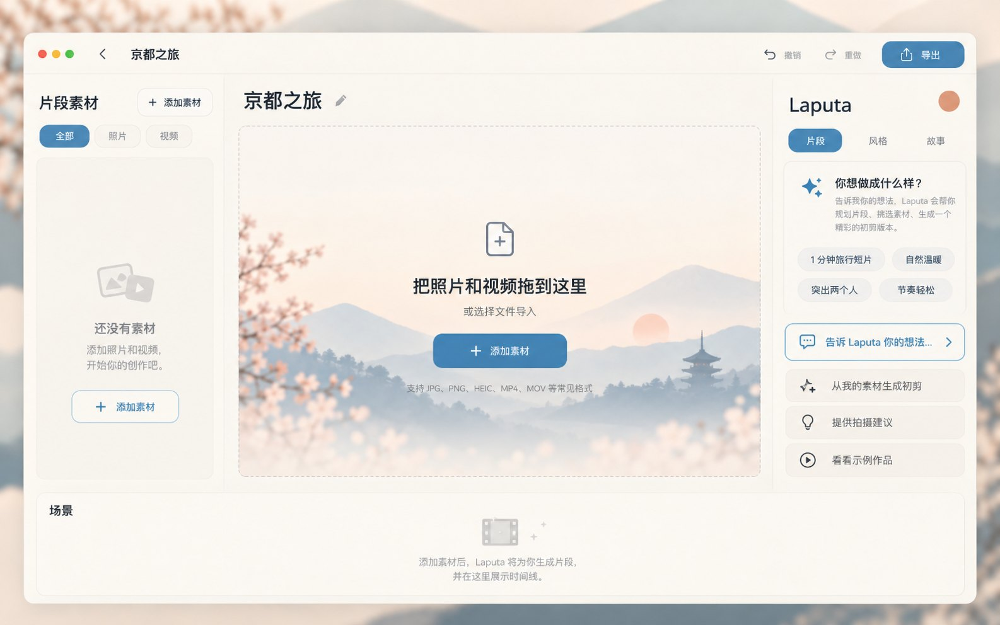
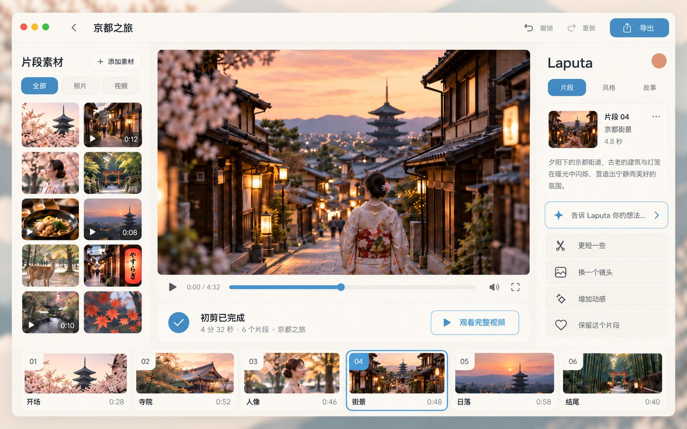

# Laputa UI/UX & Visual Vision v0.1

Status: approved visual direction  
Date: 2026-10-16  
Behavior owner: `docs/reference/PRODUCT-REQUIREMENTS-v0.1.md`  
Current implementation Story: `docs/backlog/active/LAPUTA-001-A-project-media-import.md`

## Purpose

This document is the stable V0.1 visual and interaction-direction reference for Laputa's consumer desktop UI. It exists so implementation does not reconstruct product intent from chat history or individual mockups.

The governing product idea is:

> Laputa is a calm storytelling workspace where people shape a film, not operate an editing system.

The normal user should think in terms of moments, story, scenes, selection and the resulting film. Provider/model choice, workflow graphs, low-level generation parameters and professional multi-track editing remain below the normal interaction surface.

## Design language

V0.1 uses a **flat Nordic-inspired light visual system**:

- warm off-white / oat / sand surfaces;
- large, simple color blocks rather than glassmorphism;
- restrained dusty-blue primary accent;
- small terracotta/clay details for warmth and identity;
- minimal shadows and thin separators;
- generous whitespace and low information density;
- clean editorial sans-serif hierarchy;
- rounded rectangles used consistently, without oversized playful radii;
- media content remains visually rich while application chrome stays quiet.

Avoid neon AI styling, dense control surfaces, heavy gradients, large chat transcripts, model/provider selectors and default professional NLE chrome.

## Interaction hierarchy

1. **The film/preview is the hero.** In the working state, the central Stage should have the strongest visual weight and the largest practical share of the workspace.
2. **Moments support the film.** The media browser is useful but visually secondary; it should not feel like a file manager.
3. **Laputa is contextual, not conversational chrome.** The right panel should reflect the current project/scene/selection and provide one concise natural-language entry point plus a few context-sensitive actions.
4. **Scene Strip, not default multi-track Timeline.** The bottom representation communicates story order and selection with low visual density.
5. **Selection is a language.** Selected content provides implicit edit scope; visual selection must be obvious but restrained.
6. **Progress is non-blocking.** Analysis/generation/render progress should appear locally and keep the rest of the workspace usable where possible.

## Language baseline

The approved V0.1 mockups use **Simplified Chinese as the primary visible language baseline**. User-facing copy may be refined during implementation, but should stay concise, plain-language and consumer-oriented.

Preferred product vocabulary includes:

- `片段素材` / `素材` for imported moments;
- `片段` / `场景` for story units;
- `告诉 Laputa 你的想法…` for the contextual command entry;
- `保留这个片段` instead of exposing internal lock terminology;
- `初剪已完成` for the first-cut completion state.

## Typical page baselines

These screenshots are approved reference states. They define visual hierarchy, density, composition and interaction intent; they are **not pixel-perfect implementation contracts**.

### 1. Home / project launcher

Intent:

- one obvious action to create a film;
- recent projects are the main continuation path;
- recently imported media may be visible without turning Home into an asset-management application;
- strong whitespace and a light editorial/brand moment are appropriate here.

### 2. Empty project / media import

Intent:

- the central import Stage is the dominant object;
- drag-and-drop and file selection are the primary actions;
- the empty Asset Browser communicates where imported media will appear without demanding attention;
- Laputa can suggest intent examples, but it should not force a setup wizard or configuration form;
- the Scene Strip stays quiet/empty until project state exists.

This page is the primary visual reference for the remaining GUI acceptance in `LAPUTA-001-A`.

### 3. First-cut film workspace

Intent:

- the final preview occupies the largest useful portion of the working canvas;
- the left media browser and right Laputa context panel are narrower support regions;
- the bottom Scene Strip is lightweight and storyboard-like;
- one selected scene is sufficient to establish editing scope;
- contextual actions are few, obvious and reversible.

## Implementation interpretation

When implementing these screens in GPUI:

- preserve the hierarchy and interaction model before pursuing pixel fidelity;
- prefer fewer controls and more whitespace when a choice exists;
- do not add visible technical options merely because the underlying runtime/provider exposes them;
- keep the preview larger rather than shrinking it to accommodate secondary panels;
- side panels may collapse or adapt at smaller window sizes, but the Stage remains the primary content region;
- direct manipulation (select, reorder, trim, delete) and language operate on the same project state;
- use design tokens/components for spacing, typography, surfaces, accent and selection rather than one-off styling.

If implementation evidence shows that this hierarchy prevents a required V0.1 task, route the behavior change through the normal requirement/change-control process rather than silently expanding the interface.

## Asset archive

Repository-resident visual references:

- `docs/design/assets/v0.1/01-home.jpg`
- `docs/design/assets/v0.1/02-import.jpg`
- `docs/design/assets/v0.1/03-workspace.jpg`

They are repository-friendly high-quality JPEG renders at 1586×992, retained as product design evidence and implementation references.